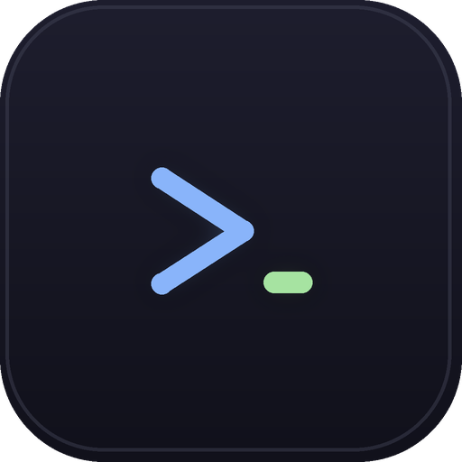
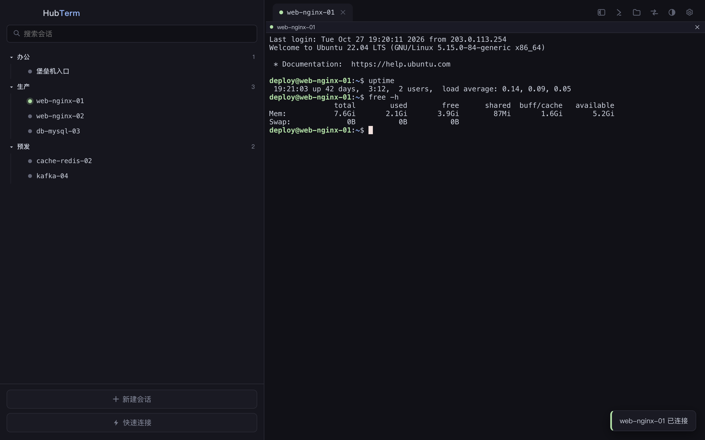

<div align="center">

**English** | [中文](README.zh-CN.md)

***



# HubTerm

**通过任意堡垒机，一键直达你的服务器。**

现代化开源 SecureCRT 替代：会话树、任意堡垒机一键直达、ZMODEM / SFTP / 端口转发，
并通过 MCP 让本地 AI Agent 安全地在你授权的主机上执行命令。

[](https://github.com/thislyc/hubterm/releases/latest)
[](https://github.com/thislyc/hubterm/releases/latest)


[](https://thislyc.github.io/hubterm/)



</div>

## 为什么做 HubTerm

多数 SSH 客户端默认 `ssh user@host`，但国内公司普遍是**菜单式堡垒机**
（`Opt>` 选主机、选用户），还常常叠一层 MFA。SecureCRT 用登录脚本解决了这个问题
——但要 $99。Termius / Tabby / WindTerm 完全不处理菜单式堡垒机。

HubTerm 的自动化是「监视器」而非「脚本」：盯着输出、应答已知提示、
出现任何意外立刻把键盘还给你。菜单改版、临时 MFA，你随时可以打断接管。

## 能力总览

| | |
|---|---|
| 🏰 **堡垒机自动化** | 每会话 expect→send 登录规则（对齐 SecureCRT Logon Actions）——唯一的自动化机制，完全可见可编辑。支持 `$PASSWORD` / `$TARGET` 变量、登录后命令、MFA 弹窗、ProxyJump。 |
| 🗂 **会话管理** | 多级文件夹会话树、拖拽排序、模糊快速打开（`⌘P`）、实时状态点、标签页（拖拽排序 / 批量关闭 / 恢复）、分屏、双击直连。 |
| 🔑 **认证与安全** | 密码 / 私钥（含口令）/ SSH Agent；密码经系统钥匙串加密（Electron safeStorage）；known_hosts 指纹固定 + 变更告警。 |
| 📦 **文件传输** | ZMODEM rz/sz（进度面板、可取消，内置 lrzsz 兼容补丁）；直连会话的 SFTP 浏览器（拖拽上传、下载、重命名、删除、可取消传输）。 |
| 🔀 **端口转发** | 按会话持久化——经堡垒机访问内网 Web/DB。 |
| 🤖 **MCP（AI Agent 接入）** | Claude Code / Cursor / ZCode 通过本地 MCP 列出主机并执行命令（仅 `127.0.0.1` + Token 鉴权、审计日志、可选执行前审批弹窗）。 |
| ⚡ **运维顺手** | 快捷命令面板 + **广播**（一条命令发到所有已连接窗格）、终端内搜索、链接可点、会话日志、快速失败连接（8 秒超时、可取消遮罩、自动重连）。 |
| 🎨 **主题与语言** | 自动 / 浅色 / 深色跟随系统；Catppuccin Mocha & Latte、Solarized Light 及按会话终端配色随主题实时切换。界面与菜单支持**中文 / English**——设置 → 语言，随时切换。 |
| 🧰 **迁移与备份** | SecureCRT 迁移会解密还原每条会话的原始 Logon Actions 为规则；`~/.ssh/config` 导入；JSON 备份导出导入。 |

## 堡垒机自动化，没有黑盒

HubTerm 里所有自动化都是你给单个会话写的「登录规则」，没有任何内置流程，
会话编辑器里全部可见：

```
等待: Opt>            发送: 3
等待: login:          发送: $TARGET
等待: Password:       发送: $PASSWORD
```

- **`$PASSWORD` / `$TARGET`** —— 会话保存的密码与目标用户，同一套规则可跨主机复用。
- **登录后命令** —— `sudo -i`、`tmux attach`，登录成功自动执行。
- **MFA** —— 检测到 MFA 提示时弹窗等你输码，验证码不会写进配置文件。
- **任何意外** —— 自动化立刻停手，终端归还给你。
- **从 SecureCRT 迁移？** 迁移工具会解密现有会话，把每条的原始 Logon Actions
  还原成对应规则。
- **ProxyJump** —— 以另一条 HubTerm 会话作为标准 SSH 跳板串接。

## MCP：让 AI Agent 在你授权的主机上干活，人在环上

HubTerm 内置 MCP server（官方 SDK，streamable HTTP）。在
设置 → **AI Agent 接入（MCP）** 开启后，把 Agent 指过来：

```json
{
  "mcpServers": {
    "hubterm": {
      "url": "http://127.0.0.1:<port>/mcp",
      "headers": { "Authorization": "Bearer <token>" }
    }
  }
}
```

- **`hubterm_list_hosts`** —— 返回会话树与 `automatable` 标记。
- **`hubterm_exec`** —— 在已保存凭据的会话上执行单条命令：干净的
  stdout/stderr、真实退出码、默认 30 秒 / 上限 300 秒超时、256KB 输出截断。

安全模型（设计如此）：

1. **默认关闭**；只绑 `127.0.0.1`，随机端口 + Bearer token。
2. 需要 MFA 或菜单应答的会话标记为不可自动化，**拒绝执行**——没有任何特例。
3. 每次调用写入 `~/.hubterm/mcp-audit.log`（JSONL 审计日志）。
4. **审批模式**：每次执行前弹窗展示目标主机与命令；30 秒无响应视为*拒绝*。

known_hosts 指纹变更 ⇒ 直接拒绝执行。设计文档见 [docs/mcp-design.md](docs/mcp-design.md)。

## 构建与安装

预编译包见 [Releases](https://github.com/thislyc/hubterm/releases/latest)
（macOS arm64/x64、Windows x64），或从源码构建（Node ≥ 20）：

```bash
npm install            # GitHub 被墙时自动走 npmmirror
npm test               # 80+ 离线测试（mock SSH 服务器 + 真实 lrzsz + MCP）
npm run package        # macOS 应用 → /Applications（跟随本机架构）
npm run package:intel  # Intel Mac 的 x64 构建
npm run package:win    # Windows x64 绿色目录 + zip（macOS/Linux 上也能交叉构建）
```

- 目前打包 **macOS**（arm64 与 x64）和 **Windows x64**；Linux 同配方可跑但未打包。
- 全栈纯 JS（`ssh2` 不带原生加速器、xterm.js、zmodem.js）——任何地方都无需原生编译。
- Windows 构建有 `wine` 时经 `rcedit` 嵌入图标/版本，否则用默认 Electron 图标
  完整可用。未签名二进制首次运行会触发 SmartScreen。

界面支持**简体中文 / English**：设置 → 语言随时切换，选择会被记住，
并同步应用于菜单、弹窗与终端提示。

## 数据存储

所有数据都在 `~/.hubterm/`——纯 JSON，无云端、无遥测：

```
~/.hubterm/
├── sessions.json      # 会话、分组、登录规则、每会话配置
├── snippets.json      # 快捷命令与广播集
├── forwards.json      # 端口转发规则
├── known_hosts.json   # 固定的主机指纹
├── mcp.json           # MCP 配置（端口/Token）、mcp-audit.log（JSONL）
└── logs/              # 每会话日志（可选）
```

密码在可用时经系统钥匙串加密存储。测试套件完全离线运行，通过
`HUBTERM_HOME=/tmp/xxx` 隔离全部数据。

## 横向对比

| | HubTerm | SecureCRT | Termius | Tabby / WindTerm |
|---|---|---|---|---|
| 菜单式堡垒机 + MFA | ✅ 规则完全可读 | ✅ 登录脚本（$99） | ❌ | ❌ |
| 自动化透明 | ✅ 每会话规则 | ⚠️ 黑盒脚本 | — | — |
| ZMODEM rz/sz | ✅ | ✅ | ❌ | ⚠️ |
| SFTP + 端口转发 | ✅ | ✅ | ⚠️ 付费档 | ✅ |
| AI Agent MCP | ✅ 内置、可审计 | ❌ | ❌ | ❌ |
| 价格 | 免费，MIT | $99 起 | 订阅制 | 免费 |

## 路线图

已完成：

- [x] Windows / Intel Mac 构建（`npm run package:win` / `package:intel`）
- [x] 本地 AI Agent 的 MCP server（列主机 / 执行、审计、审批弹窗）
- [x] 界面中英文切换（设置 → 语言）
- [x] 更新检查：应用内检查新版本，附更新日志与下载入口
- [x] 一键发版：`npm run release` 本地构建 macOS（arm64/x64）+ Windows 并直传 GitHub Releases

接下来：

- [ ] MCP：SFTP 文件工具（读/写/tail）+ Agent 会话终端投屏
- [ ] 静默自更新（macOS 需正式签名）
- [ ] 完整键盘重映射
- [ ] Mosh、Telnet、Serial 协议
- [ ] 团队同步（可自托管，商业版）

## 参与贡献

欢迎 PR——见 [CONTRIBUTING.md](CONTRIBUTING.md)。提交前请跑 `npm test`；
80+ 离线测试覆盖登录自动化引擎、ZMODEM、MCP 与存储层（对着 mock SSH 服务器）。

## 商业化

HubTerm 采用 MIT 许可，个人使用永久免费。托管团队版
（共享凭据库、同步、RBAC——可自托管）是规划中的商业化路径。

## 致谢

基于 [Electron](https://electronjs.org)、[ssh2](https://github.com/mscdex/ssh2)、
[xterm.js](https://xtermjs.org) 与 [zmodem.js](https://github.com/FGasper/zmodemjs)
构建（含 lrzsz 互操作补丁）。
